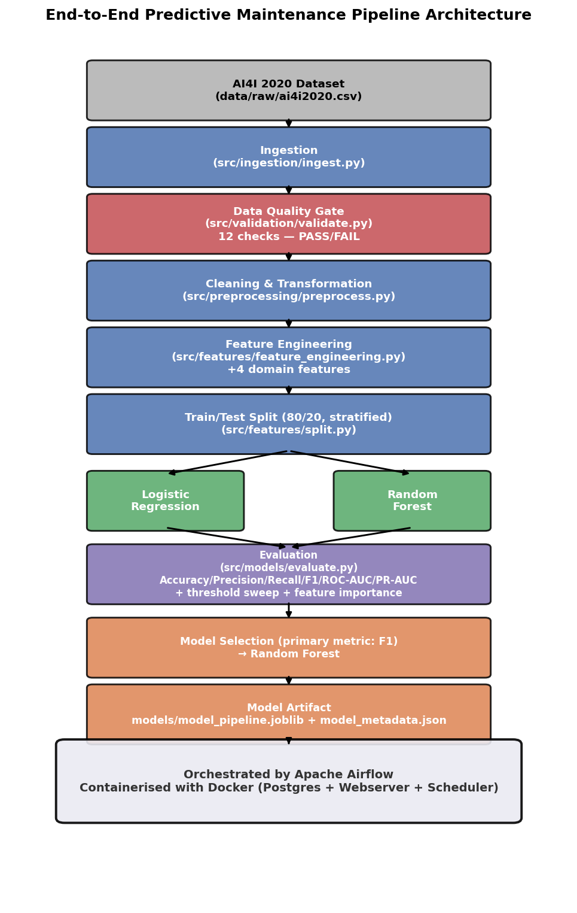
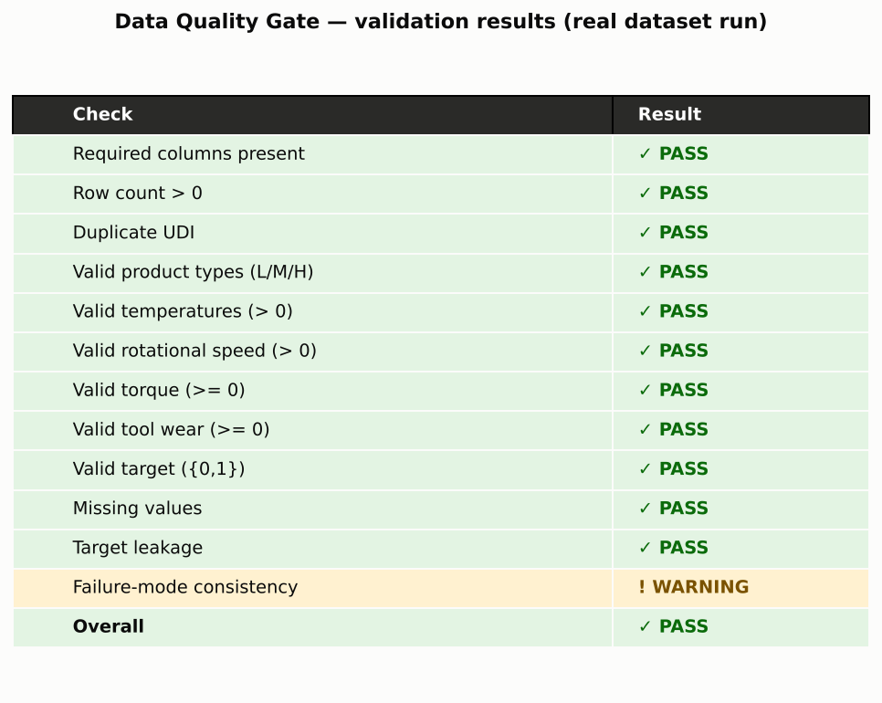
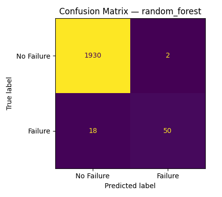
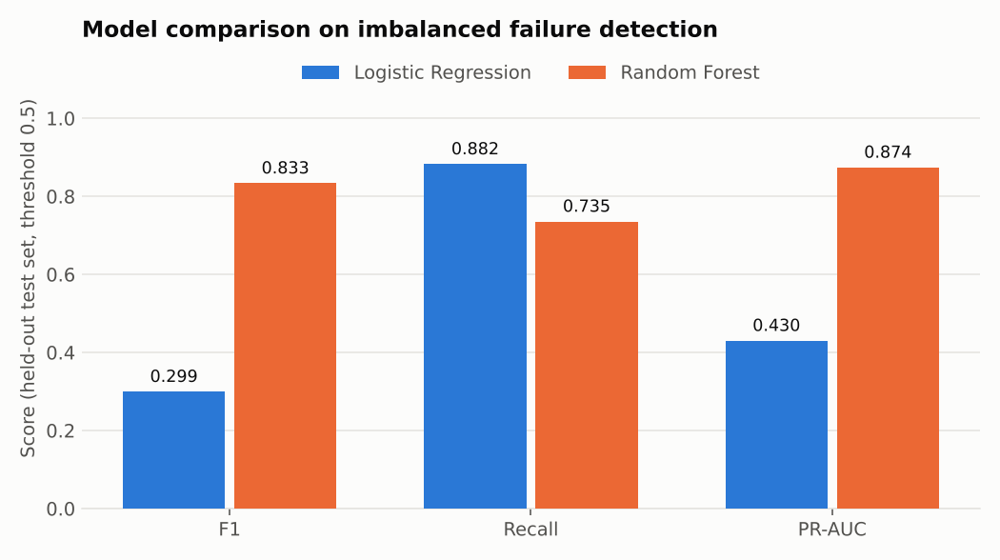
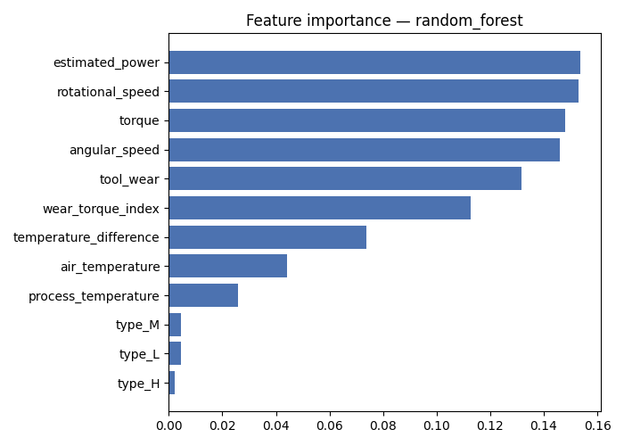
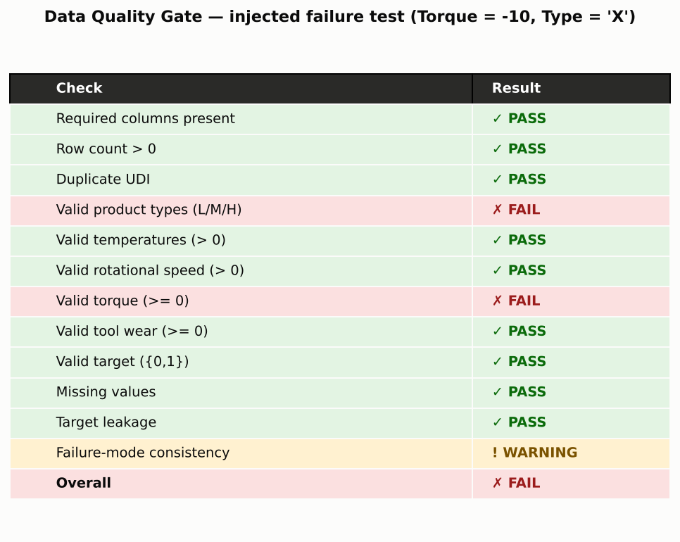
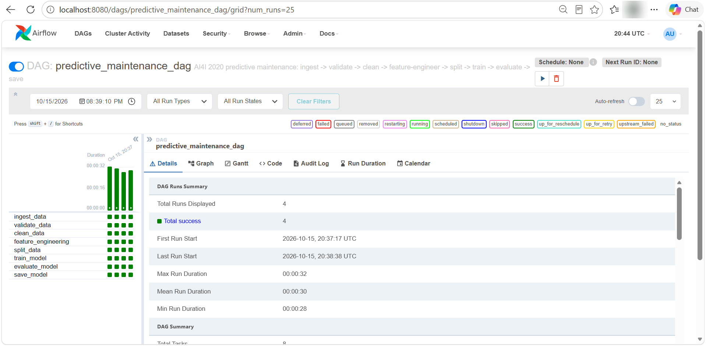
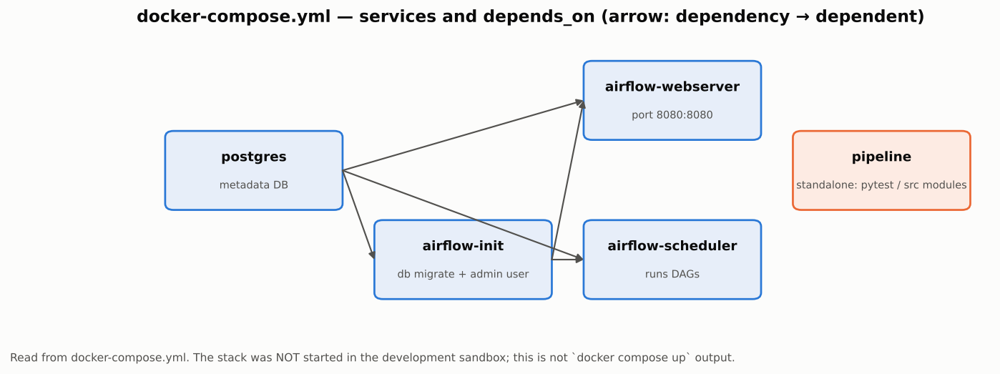
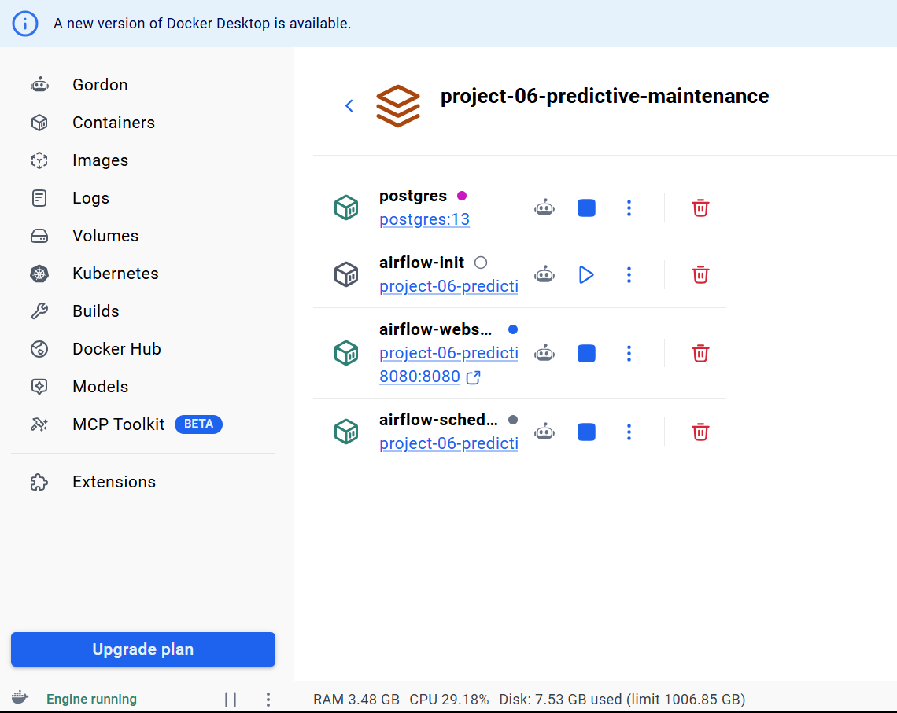
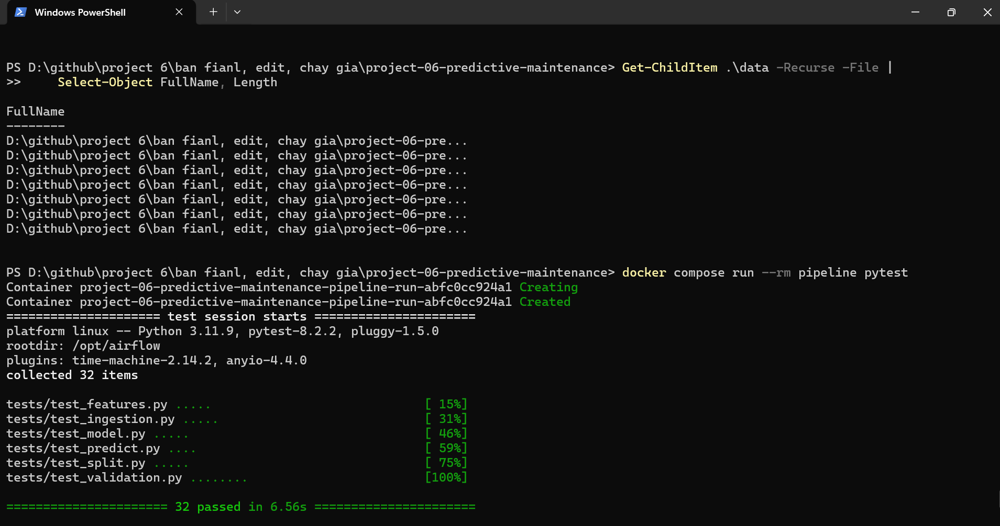

# End-to-End Predictive Maintenance Pipeline

> Status: ✅ Verified end-to-end on a real Docker stack: **32/32 tests pass under real `pytest`** (Python 3.11 container), the Airflow DAG ran **4 times, all 8 tasks green**, and the Data Quality Gate halts the pipeline on injected bad data. Screenshots below are from that run. Remaining manual items: GitHub rendering check and the `LICENSE` name — see [Verification Status](#verification-status).

## Overview
An automated, end-to-end pipeline that takes raw milling-machine sensor readings, runs them through an enforced data-quality gate, derives domain-informed engineering features, trains and compares two classifiers, and produces a reproducible machine-failure prediction artifact — orchestrated with Apache Airflow and containerised with Docker. The project is deliberately structured as a data-engineering + MLOps portfolio piece rather than a single analysis notebook: production logic lives in `src/`, notebooks are exploration-only, every pipeline stage reads/writes fixed files rather than passing objects in memory, and the Data Quality Gate is a real, tested barrier (demonstrated by intentionally corrupting the input and confirming training never runs — see Airflow Orchestration below).

## Problem Statement
Build an automated pipeline that ingests machine-operating data, validates its quality, derives engineering-informed features, trains machine-learning models, and produces reproducible machine-failure predictions. This project does not claim to predict *when* a specific real industrial machine will fail — the AI4I 2020 dataset is synthetic and the target is a binary failure/no-failure flag, not a time-to-failure estimate (see Limitations).

## Project Objectives
1. Demonstrate a genuine Data Quality Gate that can halt a pipeline, not just log a message.
2. Derive and justify a small set of domain-informed features rather than maximizing feature count.
3. Compare an interpretable baseline (Logistic Regression) against a stronger model (Random Forest) using metrics appropriate for a ~3.4% positive-class rate — not accuracy.
4. Package the trained model as a single, self-contained, inference-ready artifact.
5. Orchestrate the whole thing with Airflow and make the environment reproducible with Docker.

## Dataset
AI4I 2020 Predictive Maintenance Dataset — 10,000 observations simulating a milling machine.

**Profiling results (Milestone 2, from `reports/metrics/data_profile.json`):**

| | |
|---|---|
| Rows | 10,000 |
| Columns | 14 |
| Missing values | 0 |
| Duplicate rows / duplicate UDI | 0 / 0 |
| UDI / Product ID uniqueness | 10,000 / 10,000 (fully unique) |
| Product type split | L 60.00% · M 29.97% · H 10.03% |
| Machine failure | 0 → 9,661 · 1 → 339 (**failure rate ≈ 3.39%**) |
| Failure rate by type | H 2.09% · L 3.92% · M 2.77% |

Numeric ranges:

| Column | Min | Max | Mean | Std |
|---|---|---|---|---|
| Air temperature [K] | 295.3 | 304.5 | 300.00 | 2.00 |
| Process temperature [K] | 305.7 | 313.8 | 310.01 | 1.48 |
| Rotational speed [rpm] | 1168 | 2886 | 1538.78 | 179.28 |
| Torque [Nm] | 3.8 | 76.6 | 39.99 | 9.97 |
| Tool wear [min] | 0 | 253 | 107.95 | 63.65 |

Failure-mode occurrence counts: TWF 46 · HDF 115 · PWF 95 · OSF 98 · RNF 19.

**Note on failure-mode consistency:** 348 rows have at least one failure-mode flag set to 1, but only 339 rows have `Machine failure == 1`. There are 18 rows where a failure mode fired but `Machine failure` is 0, and 9 rows where `Machine failure == 1` with no failure mode flagged. This is an inherent property of the AI4I 2020 dataset, not an ingestion artifact — the Data Quality Gate (Phase 5) logs this as a warning rather than a hard failure.

### Why this dataset?
AI4I 2020 is small enough to run anywhere, has a realistic failure-rate imbalance (3.39%), documented failure modes and physically meaningful sensor variables, so it exercises the whole pipeline (quality gate, domain features, imbalance handling) without hiding it behind data volume. It is synthetic — see Limitations.

## Dataset Attribution
S. Matzka, "Explainable Artificial Intelligence for Predictive Maintenance Applications,"
2020 Third International Conference on Artificial Intelligence for Industries (AI4I),
pp. 69-74, DOI: 10.1109/AI4I49448.2020.00023.

Dataset: [AI4I 2020 Predictive Maintenance Dataset](https://archive.ics.uci.edu/dataset/601/ai4i+2020+predictive+maintenance+dataset), UCI Machine Learning Repository, DOI 10.24432/C5HS5C, licensed CC BY 4.0.

## Architecture


*Figure 1. End-to-end architecture of the automated predictive-maintenance pipeline.*

## Data Engineering Pipeline
Raw CSV → Ingestion (schema + row-count sanity checks, UTF-8-BOM handling) → Data Quality Gate (12 rules, hard-fails on 11 of them) → Cleaning (snake_case columns, identifier/type consistency check, drop duplicates) → Feature Engineering (4 domain-derived features) → Stratified Split → Model Training → Evaluation → standardized Model Artifact. Every stage reads and writes fixed file paths under `data/{raw,interim,validated,processed}/` rather than passing DataFrames through memory across stage boundaries — this is what lets Airflow orchestrate the same stages as independent tasks with file-based hand-offs, and what lets any single stage be re-run or inspected in isolation.

## Data Quality Validation
`src/validation/validate.py` runs 12 checks before any modeling is allowed to proceed:

| Check | Result on real data |
|---|---|
| Schema | PASS |
| Row count > 0 | PASS |
| Duplicate UDI | PASS |
| Valid product types (L/M/H) | PASS |
| Temperature > 0 | PASS |
| Rotational speed > 0 | PASS |
| Torque >= 0 | PASS |
| Tool wear >= 0 | PASS |
| Target in {0,1} | PASS |
| Missing values | PASS |
| Leakage guard | PASS |
| Failure-mode consistency | **WARNING** (27 rows inconsistent — known AI4I dataset quirk, non-fatal) |
| **Overall** | **PASS** |

Any of the first 11 checks failing flips overall status to `FAIL` and halts the pipeline (verified with an injected negative-torque / invalid-Type test). The 12th check is intentionally a warning, not a hard failure — see the Dataset section above. Full machine-readable output: `reports/metrics/data_quality_report.json`.



*Figure 2. Data-quality validation checks performed before machine-learning training, generated from the actual `data_quality_report.json` output on the real dataset.*

## Feature Engineering
`src/preprocessing/preprocess.py` cleans the validated data: renames columns to snake_case, cross-checks `product_id`'s leading letter against `type` (0 mismatches on the full dataset — `type` is fully consistent with `product_id`), and defensively drops duplicates (0 found). `udi` and `product_id` are retained in the cleaned dataset for traceability but are excluded from the ML feature matrix.

`src/features/feature_engineering.py` then derives 4 domain-informed features:

| Feature | Formula | Mean (full dataset) |
|---|---|---|
| `temperature_difference` | `process_temperature - air_temperature` | 10.00 K |
| `angular_speed` | `rotational_speed * 2π / 60` | rad/s |
| `estimated_power` | `torque * angular_speed` | ~6,350 W |
| `wear_torque_index` | `tool_wear * torque` | 4,314.66 |

Verified with unit tests using a worked example (rpm=60 → angular_speed=2π rad/s, power=10×2π W for torque=10). Output: `data/processed/features.csv` (10,000 rows × 18 columns).

## Machine Learning

### Train/test split (Phase 8)
`src/features/split.py` performs a stratified 80/20 split on `data/processed/features.csv`, seeded with `random_state=42`.

| Split | Rows | Failure rate |
|---|---|---|
| Train | 8,000 | 3.39% |
| Test | 2,000 | 3.40% |

Verified: 0 UDI overlap between train/test, and the split is reproducible (same rows every run given the fixed seed).

## Handling Class Imbalance
Both models use `class_weight="balanced"`. Accuracy is reported but treated as uninformative on its own (a model predicting "no failure" always would score ~96.6% accuracy while catching zero real failures) — model selection is driven by F1/recall/PR-AUC instead.

## Model Evaluation
Results below come from the pinned Docker environment (Python 3.11, versions in `requirements-docker.txt`) — the same environment that produced the Airflow run shown later. Trained on `data/processed/train.csv` (8,000 rows), evaluated on the held-out `data/processed/test.csv` (2,000 rows, never seen during training):

| Model | Accuracy | Precision | Recall | F1 | ROC-AUC | PR-AUC |
|---|---|---|---|---|---|---|
| Logistic Regression | 0.860 | 0.180 | **0.882** | 0.299 | 0.938 | 0.430 |
| Random Forest | 0.990 | **0.962** | 0.735 | **0.833** | **0.979** | **0.874** |

**Selection criterion:** primary metric is F1-score, with recall weighted heavily given the operational cost of a missed failure. **Selected model: Random Forest.**

Confusion matrices at the default 0.5 threshold:
- Logistic Regression: TN=1659, FP=273, **FN=8**, TP=60 — catches almost every failure but floods operators with false alarms.
- Random Forest: TN=1930, FP=2, **FN=18**, TP=50 — very few false alarms, but it misses more true failures than LR at this threshold.



*Figure 3. Confusion matrix for the selected model (Random Forest) on the held-out test set.*

**Threshold analysis:** sweeping the decision threshold from 0.3–0.7, Random Forest's F1 on the test split peaks at **0.4** (F1=0.889, recall=0.824, precision=0.966) versus 0.843 at 0.5 (recall 0.750, precision 0.962). The 0.843 in the sweep differs from the 0.833 in the table above by one borderline failure (recall 51/68 vs 50/68), consistent with a case whose probability is exactly 0.5 being negative under `predict()` but positive under the sweep's `>= 0.5` rule. Caveat: the 0.4 optimum comes from one split with 68 positives and did **not** replicate in cross-validation (below), where mean F1 is flat between 0.5 and 0.6 — so pick the threshold from the cost of a missed failure versus a false alarm rather than from this single sweep. Full sweep: `reports/metrics/evaluation.json`.



*Figure 4. Logistic Regression vs Random Forest on the held-out test set (threshold 0.5), generated from `reports/metrics/model_comparison.csv`.*

### How stable are these numbers?
The test set contains only 68 failures, so a handful of borderline cases changes F1 by several points. `python -m src.models.stability_check` runs 5×3 repeated stratified cross-validation on all 10,000 rows (339 failures, same pipelines, refit per fold; output `reports/metrics/stability_check.json`):

| Model (threshold 0.5) | F1 | Precision | Recall | PR-AUC |
|---|---|---|---|---|
| Logistic Regression | 0.276 ± 0.012 | 0.165 ± 0.007 | 0.847 ± 0.048 | 0.452 ± 0.049 |
| Random Forest | 0.854 ± 0.026 | 0.885 ± 0.046 | 0.828 ± 0.039 | 0.883 ± 0.031 |

(mean ± std over 15 folds). **Environment note:** this table was computed in the development sandbox (Python 3.13, scikit-learn 1.9.1, see `requirements-sandbox.txt`), not in the Docker image; reproduce it there with `docker compose run --rm pipeline python -m src.models.stability_check`. The conclusion — Random Forest far ahead on F1/PR-AUC, Logistic Regression higher recall but many false alarms — is stable; the exact second decimal of the single-split F1 is not.

## Explainability
Random Forest feature importance is dominated by the engineering-informed and raw operating variables — `estimated_power`, `rotational_speed`, `torque`, `angular_speed` and `tool_wear` together account for the large majority of importance, while `type` contributes almost nothing.



*Figure 5. Feature importance of the selected model, highlighting the operational variables most strongly associated with machine-failure predictions.*

This is broadly consistent with the engineering failure mechanisms encoded in the synthetic dataset (power- and wear-related stress driving failure), though it should not be read as the model having "discovered" the underlying physical laws — it learned statistical associations in a synthetic dataset that happens to be generated from those mechanisms.

## Airflow Orchestration
`dags/predictive_maintenance_dag.py` wires the 8-task pipeline to real `src/` logic via `dags/pipeline_tasks.py` (a pure-Python module with no Airflow import, so the task functions are independently testable):

```
ingest_data -> validate_data -> clean_data -> feature_engineering
-> split_data -> train_model -> evaluate_model -> save_model
```

`validate_data` raises `DataQualityGateError` on a failed gate; Airflow surfaces this as a task failure, and downstream tasks (crucially `train_model`) never run — Airflow only proceeds along a `>>` edge once the upstream task succeeds.

**Verified without Airflow installed** (this development sandbox has no network access to install Airflow — see `requirements.txt` for the pinned version to use locally) via `dags/_simulate_dag_run.py`, which executes `pipeline_tasks.TASK_SEQUENCE` in order exactly as Airflow's dependency graph would:

- **Clean run (sandbox simulation):** all 8 tasks succeed end-to-end on the real 10,000-row dataset (train 3.39% / test 3.40% failure rate, Random Forest selected). Full log: `reports/logs/dag_run_success.log`. That log was produced in the development sandbox with newer libraries (scikit-learn 1.9.1), so its Random Forest figures (F1 0.859) differ from the Docker/Airflow results reported above (F1 0.833) — see Reproducibility.
- **Data Quality Failure Demo:** injecting a negative torque value into the raw CSV causes `validate_data` to FAIL with `torque_non_negative: FAIL`; the simulated run halts immediately and `train_model`/`evaluate_model` never execute — confirmed by no new model artifacts being written. This is the project's evidence that the Data Quality Gate is a real, enforced barrier and not just code that exists on paper. Full log: `reports/logs/dag_run_data_quality_failure_demo.log`. Excerpt:



*Figure 6. Data Quality Gate result for a deliberately corrupted copy of the dataset (Torque = -10, Type = "X"); `reports/metrics/data_quality_report_failure_demo.json`.*

```
"torque_non_negative": "FAIL",
...
"errors": ["Found 1 row(s) with negative torque."],
"status": "FAIL"

[TASK FAILED] validate_data: Data Quality Gate FAILED — see reports/metrics/data_quality_report.json.
Halting pipeline; train_model will not run.
Downstream tasks will NOT run (matches Airflow's dependency behavior).
```

**Verified on real Airflow 2.9.3 (Docker Compose):** `predictive_maintenance_dag` was triggered four times from the UI; all four runs succeeded with all 8 tasks green (runs of 28–32 s each).



*Figure 7. Airflow 2.9.3 UI (`localhost:8080`), Grid view of `predictive_maintenance_dag`: 4/4 runs successful, all 8 tasks green. Screenshot taken on 15 Oct 2026 from the Docker Compose stack.*

**Known issue found and fixed after this run:** the scheduler/webserver logs showed `AirflowTaskTimeout: DagBag import timeout for /opt/airflow/dags/pipeline_tasks.py after 30.0s`, because `pipeline_tasks.py` imported pandas/scikit-learn at module level and Airflow re-imports the file on every DAG parse (slow on Docker Desktop bind mounts). The runs themselves still succeeded. The heavy imports now happen lazily inside each task, and `AIRFLOW__CORE__DAGBAG_IMPORT_TIMEOUT` is raised to 120 s in `docker-compose.yml`. Import time of the module dropped to ~0.02 s and the simulated DAG run and all 32 tests still pass; this change has not been re-run inside Docker, so please rebuild (`docker compose build`) and confirm the warning is gone.

To run without Docker: `pip install apache-airflow==2.9.3`, point `AIRFLOW_HOME/dags` at this repo's `dags/` folder, `airflow standalone`, then trigger `predictive_maintenance_dag` from the UI.

## Docker
`docker-compose.yml` provides a full reproducible stack, all built from a single `Dockerfile` (official `apache/airflow:2.9.3-python3.11` base + `requirements-docker.txt` for the project's data/ML dependencies + the project code baked in):

| Service | Role |
|---|---|
| `postgres` | Airflow metadata database |
| `airflow-init` | one-off: run DB migrations + create the `admin`/`admin` user |
| `airflow-webserver` | Airflow UI at `http://localhost:8080` |
| `airflow-scheduler` | executes DAG runs |
| `pipeline` | runs `pytest` or any `src/` module standalone, without Airflow at all |

```bash
docker compose up airflow-init                                  # first time only
docker compose up -d postgres airflow-webserver airflow-scheduler
# open http://localhost:8080 (admin/admin), trigger predictive_maintenance_dag

docker compose run --rm pipeline pytest                          # run the test suite in isolation
docker compose run --rm pipeline python -m src.ingestion.ingest  # run any module standalone
```



*Figure 8. Service dependency graph read from `docker-compose.yml` (a generated diagram of the configuration).*



*Figure 9. Docker Desktop showing the stack from this project: `postgres`, `airflow-webserver` (8080) and `airflow-scheduler` running; `airflow-init` is the one-off job that has finished.*

Design choices worth noting:
- `requirements-docker.txt` deliberately excludes `apache-airflow` itself — reinstalling Airflow on top of its own official image is a common source of broken dependency resolution. Diffing it against the root `requirements.txt` (used for a plain local `pip install`, no Docker) confirms the only differences are `apache-airflow` and `jupyter`, both intentionally Docker-image-only exclusions.
- `airflow-webserver` and `airflow-scheduler` each declare explicit `depends_on: {postgres: service_healthy, airflow-init: service_completed_successfully}` rather than relying on YAML anchor inheritance — a `depends_on` key defined directly on a service fully replaces (does not merge with) one pulled in via a YAML merge key, so leaving it implicit would silently drop the `postgres` health-check dependency.
- On Linux hosts, if the mounted `data/`, `models/`, `reports/` directories end up owned by root, set `AIRFLOW_UID=$(id -u)` in a `.env` file next to `docker-compose.yml` before running; the compose file passes it as `user: "${AIRFLOW_UID:-50000}:0"` to every Airflow service and to `pipeline`.
- `airflow-init` uses `airflow db migrate` (the non-deprecated command) and only tolerates the *user-already-exists* case, so a failed migration is no longer masked.

**Verification status:** the stack was built and run on Docker Desktop (Windows): `airflow-init`, `postgres`, `airflow-webserver` and `airflow-scheduler` started, the DAG ran successfully (Figure 7), and `docker compose run --rm pipeline pytest` passed 32/32 (Figure 10). A static review beforehand had found and fixed three compose issues (ineffective `AIRFLOW_UID` tip, deprecated `db upgrade`, `|| true` masking migration failures).

## Verification Status
| Item | Result |
|---|---|
| Unit tests | ✅ 32/32 pass under real `pytest 8.2.2` in the Docker image (Figure 10) |
| Pipeline end-to-end | ✅ 8/8 tasks pass in Airflow (4 successful runs, Figure 7); all outputs present; features CSV 10,000×18 |
| README metrics vs result files | ✅ Headline numbers match `reports/metrics/*` from the Docker run (checked by script); stability table is from a different environment and is labelled as such |
| Data Quality Gate failure | ✅ injected bad data halts before training (Figure 6); raw data restored (md5 checked) |
| Docker Compose | ✅ stack built and running on Docker Desktop (Figure 9) |
| Airflow UI | ✅ real screenshot (Figure 7) |
| DagBag import-timeout fix | ⚠️ applied afterwards; verified in the sandbox only — rebuild and confirm in Docker |
| GitHub rendering | ⚠️ not checked; all image links point to files that exist in `reports/figures/` |

## Testing
32 unit tests across `tests/test_ingestion.py`, `test_validation.py`, `test_features.py`, `test_split.py`, `test_model.py`, `test_predict.py` — covering file/schema checks, all 12 validation rules (including the failure-mode-consistency warning-vs-fail distinction), worked-example feature formulas, stratified-split integrity, model train/predict shape and probability-range checks, and end-to-end single-observation inference.

Run with:
```
pytest                                          # local
docker compose run --rm pipeline pytest         # in the project's Docker image
```



*Figure 10. `docker compose run --rm pipeline pytest` in the project image: Python 3.11.9, pytest 8.2.2, 32 passed in 6.56 s.*

`tests/_run_tests_without_pytest.py` is a minimal fallback runner kept only for environments where pytest cannot be installed (it was used in the offline development sandbox); real pytest is the reference.

## Project Structure
```
project-06-predictive-maintenance/
├── dags/
│   ├── predictive_maintenance_dag.py
│   ├── pipeline_tasks.py
│   └── _simulate_dag_run.py
├── src/
│   ├── ingestion/
│   ├── validation/
│   ├── preprocessing/
│   ├── features/
│   │   ├── feature_engineering.py
│   │   └── split.py
│   ├── models/            # train, evaluate, predict, stability_check
│   └── utils/             # make_figures
├── data/{raw,interim,validated,processed}/
├── models/
├── reports/{figures,metrics,logs}/
├── tests/
├── notebooks/
├── config/
├── Dockerfile
├── docker-compose.yml
├── requirements.txt
├── requirements-docker.txt
├── requirements-sandbox.txt
└── README.md
```

## Reproducibility
- `random_state=42` fixed everywhere it matters: train/test split, Logistic Regression, Random Forest.
- Every stage reads/writes to fixed paths in `config/config.yaml` rather than hardcoded strings scattered across modules.
- `data/raw/ai4i2020.csv` is never modified in place — every downstream stage produces a new file (`interim/` → `validated/` → `processed/`), so the raw dataset can always be re-ingested from scratch.
- **Environment sensitivity (measured, not assumed):** the same code and `random_state=42` give Random Forest F1 **0.833** (Docker, pinned versions, Python 3.11) but **0.859** with newer libraries (Python 3.13, scikit-learn 1.9.1, pandas 3.0.5). Logistic Regression and the stratified split are identical in both. All headline numbers in this README are from the pinned Docker environment; use `docker compose` to reproduce them exactly. Because the test split has only 68 failures, the cross-validated stability check above is reported alongside.
- `requirements.txt` / `requirements-docker.txt` pin versions and were exercised by the Docker build and test run. `requirements-sandbox.txt` records the newer, unpinned-era versions used only for the extra stability check and the 0.859 comparison.

## Results
On the held-out test set (2,000 rows, never seen during training): Random Forest was selected (F1=0.833, PR-AUC=0.874, recall=0.735, precision=0.962), clearly outperforming the Logistic Regression baseline (F1=0.299) on the primary F1 criterion, though LR achieves a notably higher recall (0.882) at the cost of far more false alarms (273 vs 2). See Model Evaluation above for the full breakdown, confusion matrices, and threshold analysis.

## Limitations
1. Synthetic dataset, not production sensor data.
2. No true longitudinal machine history.
3. Binary failure/no-failure prediction only (no time-to-failure).
4. Failure-mode labels (TWF/HDF/PWF/OSF/RNF) are used only for post-hoc analysis, never as model inputs.
5. No real industrial deployment validation.

## Future Improvements
1. Real industrial sensor data (validate against actual PLC/SCADA feeds, not just the synthetic AI4I dataset).
2. Time-series / sequence modeling instead of independent-row classification.
3. Remaining Useful Life (RUL) regression instead of a binary failure flag.
4. SHAP-based per-prediction explainability, beyond global feature importance.
5. MLflow experiment tracking and a model registry (deliberately deferred — see project plan's guidance that this is a valuable but non-core addition).
6. CI/CD (GitHub Actions running `pytest` + the Data Quality Gate on every push).
7. Cloud deployment (managed Airflow + a served model endpoint).
8. Streaming ingestion instead of batch CSV files.
9. Concept-drift monitoring on the incoming feature distributions.
10. A calibrated, operationally-chosen decision threshold (this project's threshold-sweep analysis is a first step, not a final answer — a real deployment would set this with the maintenance team based on the cost of a false alarm vs. a missed failure).

## How to Run
1. Clone the repository.
2. Download the AI4I 2020 dataset and place it at `data/raw/ai4i2020.csv` (already included in this delivery).
3. **Local (no Docker):**
   ```bash
   python -m venv .venv && source .venv/bin/activate
   pip install -r requirements.txt
   python -m src.ingestion.ingest
   python -m src.validation.validate
   python -m src.preprocessing.preprocess
   python -m src.features.feature_engineering
   python -m src.features.split
   python -m src.models.train
   python -m src.models.evaluate
   pytest
   ```
   Or run the whole thing at once the way Airflow would: `python dags/_simulate_dag_run.py`.
4. **Docker + Airflow:**
   ```bash
   docker compose up airflow-init
   docker compose up -d postgres airflow-webserver airflow-scheduler
   # open http://localhost:8080 (admin/admin) and trigger predictive_maintenance_dag
   docker compose run --rm pipeline pytest
   ```
5. Inspect `reports/metrics/data_quality_report.json`, `reports/metrics/evaluation.json`, and `reports/figures/*.png` for full results.
6. Inspect `models/model_pipeline.joblib` + `models/model_metadata.json` for the final artifact.
7. Run a prediction: see Example Prediction below.

## Example Prediction
```python
from src.models.predict import predict

result = predict({
    "Type": "M",
    "Air temperature [K]": 298.1,
    "Process temperature [K]": 308.6,
    "Rotational speed [rpm]": 1551,
    "Torque [Nm]": 42.8,
    "Tool wear [min]": 0,
})
# {'failure_probability': 0.0, 'prediction': 'NO FAILURE'}
```

A higher-risk observation (`Type` L, air 300.0 K, process 310.5 K, 1380 rpm, torque 60.0 Nm, tool wear 240 min) yields a high failure probability and `'prediction': 'MACHINE FAILURE'` (0.957 measured with scikit-learn 1.9.1; the exact value in the pinned Docker build may differ slightly), confirming the model responds in the expected direction to the engineering-informed risk factors.

## Git Commit Strategy
Rather than one final `git add . && git commit -m "finished project"`, commit along milestone boundaries so the history itself documents the build order:

```
1.  initial project structure
2.  add dataset ingestion pipeline + data profiling
3.  implement data validation (Data Quality Gate)
4.  add exploratory data analysis
5.  add cleaning + domain-informed feature engineering
6.  implement train/test split
7.  implement baseline models (Logistic Regression + Random Forest) + evaluation
8.  add standardized model artifact + single-observation prediction
9.  add unit test suite
10. add Airflow DAG + Data Quality Gate failure demo
11. add Docker/Airflow/Postgres stack
12. add architecture diagrams + finalize README
```

## GitHub Audit Checklist
Before pushing:
- [ ] Fill in your real name in `LICENSE` (currently `[YOUR NAME HERE]`).
- [ ] Confirm `.gitignore` excludes `data/interim/`, `data/validated/`, `data/processed/` CSVs and `models/*.joblib` — these are regenerable and were deliberately kept out of git to avoid a bloated, driftable repo (see `.gitignore` comments). `data/raw/ai4i2020.csv` and `models/model_metadata.json` ARE tracked.
- [x] `pytest` run for real (Docker image, 32 passed).
- [x] `docker compose` stack run for real on Docker Desktop.
- [x] `predictive_maintenance_dag` triggered from the real Airflow UI (Figure 7).
- [ ] After the DagBag import fix: `docker compose build`, re-trigger the DAG once, confirm the 30 s timeout warning is gone.
- [ ] Optional: re-take the Docker/pytest screenshots from a folder with a clean path (current ones show the local folder name).
- [ ] Double check no local absolute paths (e.g. `/home/claude/...`) leaked into any committed file — this repo was developed under `/home/claude/project-06-predictive-maintenance`; all code uses relative paths, but worth a final `grep -r "/home/" .` before pushing.
- [ ] Confirm `__pycache__/`, `.pytest_cache/`, and `.ipynb_checkpoints/` are not accidentally staged.

## References
- S. Matzka (2020), see Dataset Attribution above.
